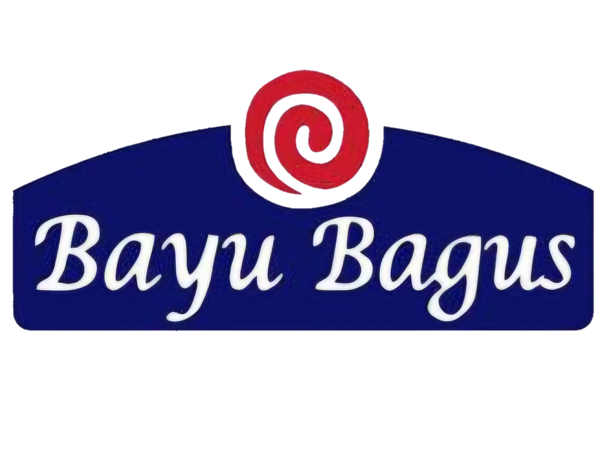

<div align="center">
  

  # Bayu Bagus Bakery
  *Profil pabrik roti dan pusat kontak grosir resmi sejak 1995.*

  [Fitur](#fitur) • [Pemasangan](#pemasangan) • [Penggunaan](#penggunaan)
</div>

Situs profil resmi dan pusat pemesanan grosir PT Bayu Bagus Bakery, pabrik roti yang beroperasi di Desa Garu, Baron, Nganjuk sejak 1995. Dibangun memakai Vanilla JavaScript dan Vite dengan gaya buku besar klasik tanpa kartu SaaS, dilengkapi video fasilitas produksi, izin edar BPOM serta Halal resmi, dan jalur komunikasi WhatsApp langsung.

## Fitur
- **Tampilan Buku Besar Klasik** - Tata letak cetak bersih dengan garis pembatas ganda tanpa kartu bertumpuk atau bayangan tebal.
- **Pemutar Video Fasilitas** - Video tur pabrik dengan pemuatan tunda agar halaman tetap ringan dibuka.
- **Katalog Grosir Terbuka** - Daftar produk unggulan mencakup Roti Sisir, Universal Mooncake, Pia Tradisional, serta tabel spesifikasi lengkap.
- **Keterbukaan Legalitas** - Izin edar resmi BPOM RI MD 236013017961, sertifikasi Halal BPJPH, dan standar sanitasi CPPOB.
- **Pemesanan WhatsApp Langsung** - Format pesan otomatis untuk pedagang, toko kelontong, dan pengelola acara.

## Pemasangan
```bash
# Gandakan repositori
git clone https://github.com/your-username/BayuBagusBakery.git
cd BayuBagusBakery

# Pasang dependensi lewat Bun
bun install
```

## Penggunaan
```bash
# Jalankan server pengembangan lokal (http://localhost:5173/)
bun run dev

# Kompilasi berkas produksi ke dist/
bun run build

# Pratinjau hasil kompilasi lokal
bun run preview
```
